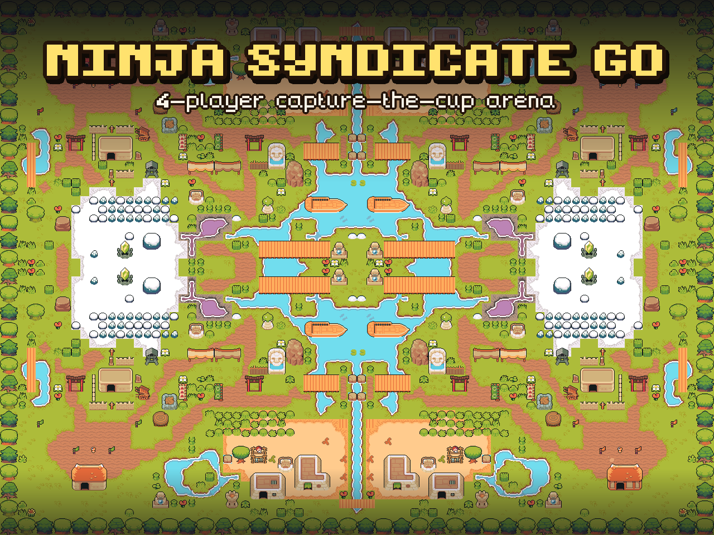
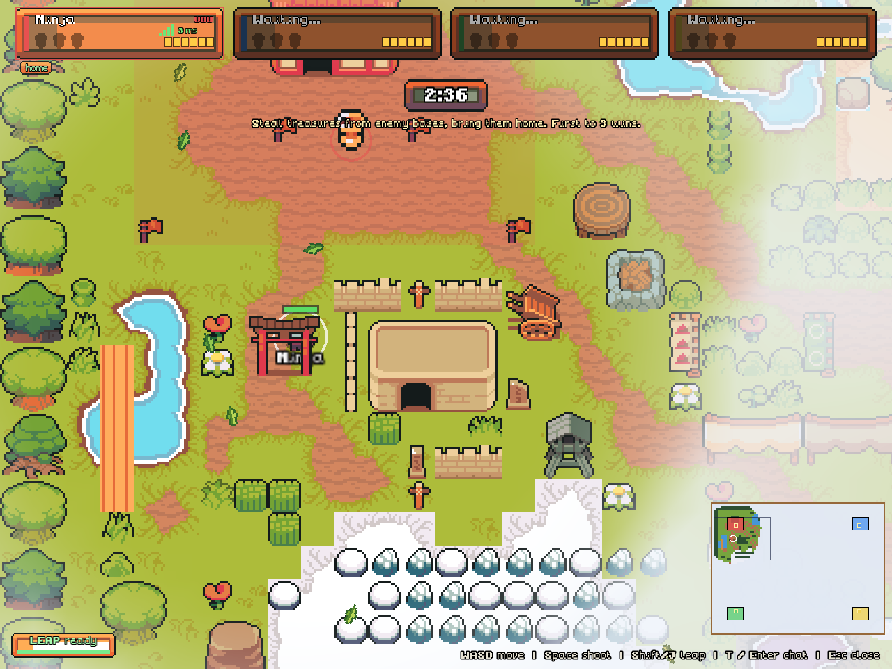
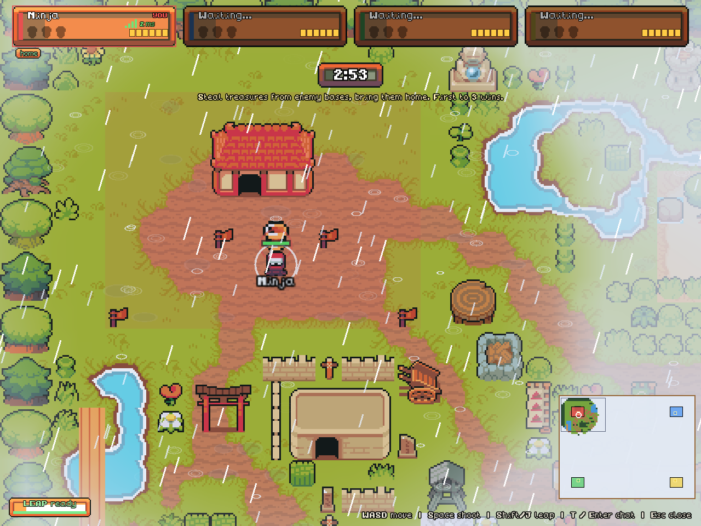
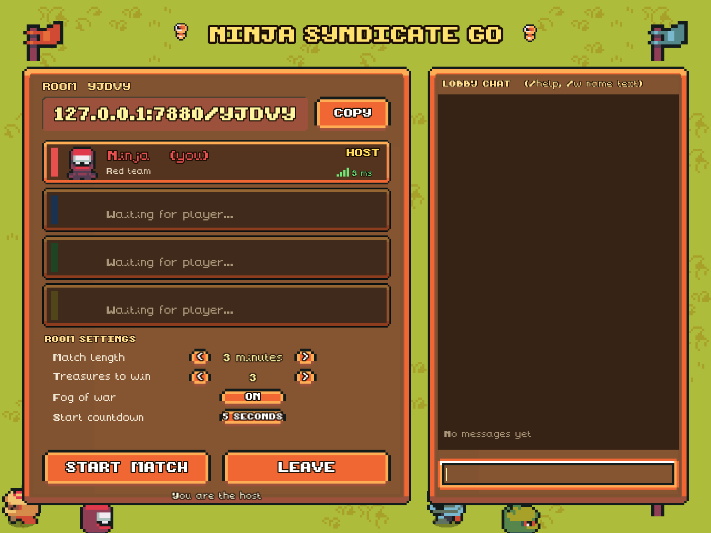
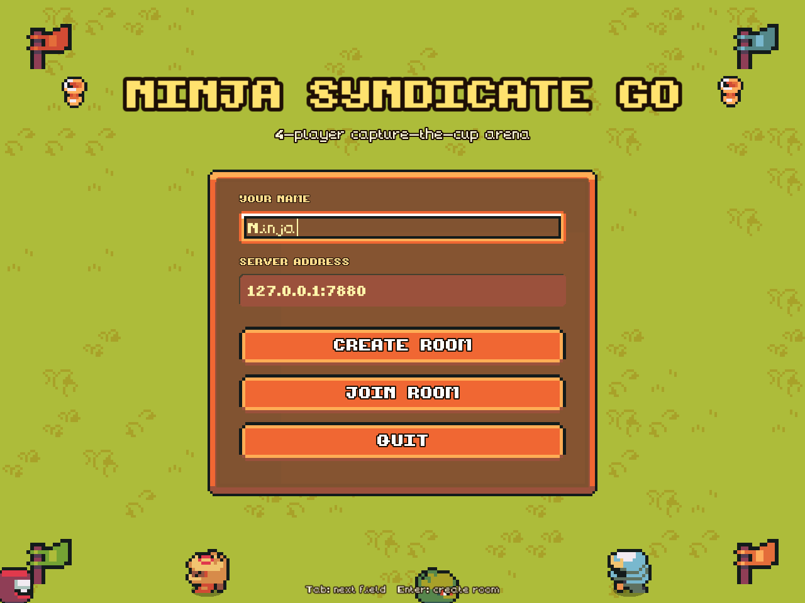

<p align="center">
  
</p>

# ninja_syndicate_go

A 4-player online arena game built with **C++17** and **SFML 3**. Each player guards a trophy in their corner base and tries to
steal the trophies of the other three. Carry one home to score, shoot carriers to make them drop it, leap over water, and find
the secret hedge corridors. First to the target score wins.

## Screenshots

| | |
|---|---|
|  |  |
|  |  |

## Play

Download the Windows build from the [Releases](../../releases) page, unzip it and run `ninja_syndicate_go.exe`.
Create a room, share the join string with your friends, and start the match.

**Controls:** `WASD` move · `Space` shoot · `Shift`/`J` leap · `T`/`Enter` chat · `M` mute

## Build from source

Requires CMake 3.28+, Ninja and a C++17 compiler. SFML 3.1 is downloaded automatically by CMake.

```bash
cmake -S . -B build -G Ninja -DCMAKE_BUILD_TYPE=Release
cmake --build build
```

This produces `build/bin/game_server` and `build/bin/game_client`. Run both from the repository root so the client finds the assets:

```bash
./build/bin/game_server [port]                      # default port 7777 (TCP)
./build/bin/game_client [host] [port] [name]
```

## Licenses

- **Art and sound effects:** [Ninja Adventure Asset Pack](https://pixel-boy.itch.io/ninja-adventure-asset-pack) by Pixel-boy and AAA, [CC0 1.0](https://creativecommons.org/publicdomain/zero/1.0/).
- **Extra music:** by Kevin MacLeod ([incompetech.com](https://incompetech.com)), licensed under [CC BY 4.0](https://creativecommons.org/licenses/by/4.0/):
  "Sneaky Snitch", "Pixelland", "Carefree", "Monkeys Spinning Monkeys", "Wallpaper", "Black Vortex", "Hot Pursuit",
  "Volatile Reaction", "Prelude and Action".
- **[SFML](https://www.sfml-dev.org/):** zlib/libpng license.
